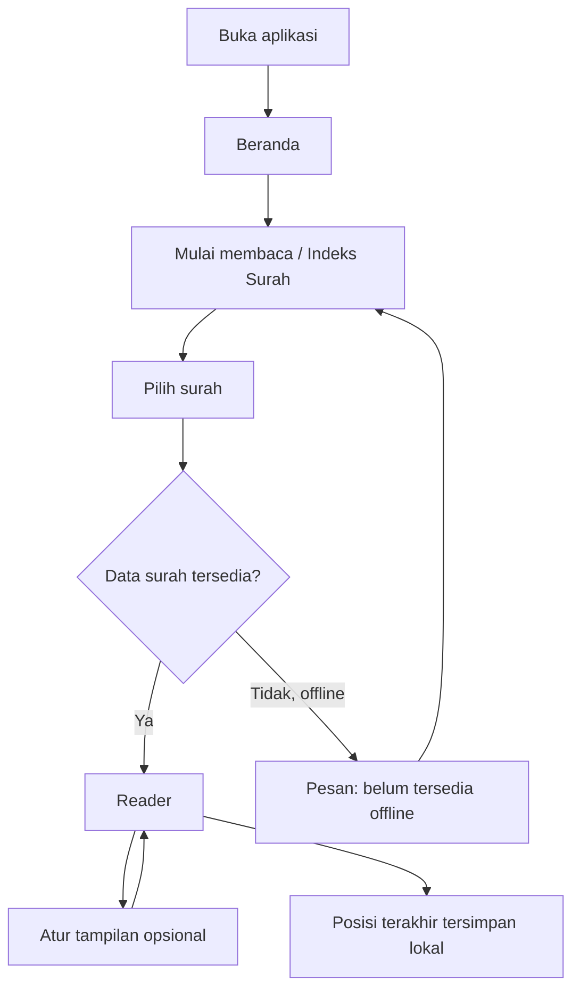
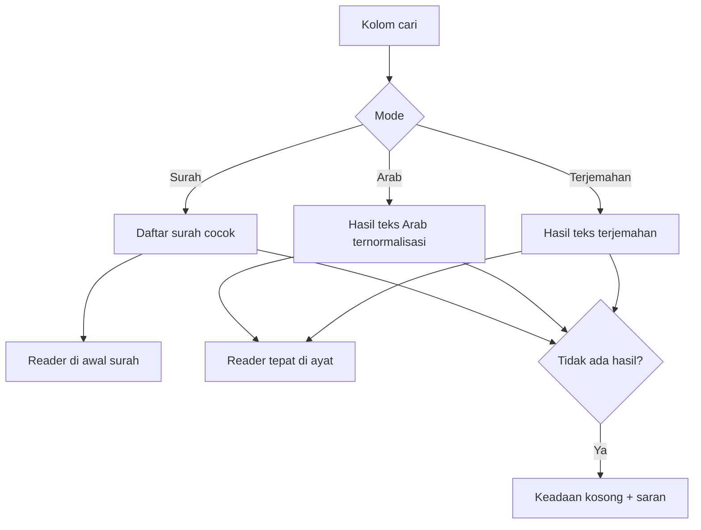

# User Flows

## Quran PWA

**Versi:** 1.0
**Tanggal:** 2026-11-12
**Acuan:** PRODUCT-SPECIFICATION.md (Journey A–D), SCREEN-SPECS.md

Prinsip alur: **tanpa akun, tanpa onboarding wajib, offline-first.** Kode layar (S01–S11) merujuk `SCREEN-SPECS.md`.

---

## F01 — Membaca tanpa akun (Journey A)

**Pemicu:** pengguna membuka aplikasi untuk pertama kali.

| Langkah | Layar               | Keterangan                             |
| ------- | ------------------- | -------------------------------------- |
| 1       | S01 Beranda         | Tombol utama "Mulai membaca"           |
| 2       | S02 Indeks Surah    | Pilih surah                            |
| 3       | S03 Reader          | Data surah dimuat (lokal)              |
| 4       | S05 Pengaturan Baca | Opsional: ubah ukuran/tema             |
| 5       | S03 Reader          | Membaca dan menggulir                  |
| 6       | —                   | Posisi terakhir tersimpan di perangkat |

**Titik keputusan**

- Data surah belum ada (offline kunjungan pertama) → pesan "Surah ini belum tersedia offline…" (S03).
- Penyiapan offline berjalan di latar → kemajuan tampil di S11 tanpa memblokir.

**Berhasil:** pengguna membaca tanpa mendaftar atau melewati onboarding.

---

## F02 — Memberi penanda (Journey B)

| Langkah | Layar          | Keterangan                                          |
| ------- | -------------- | --------------------------------------------------- |
| 1       | S03 Reader     | Ketuk ikon penanda atau tombol Aksi pada ayat       |
| 2       | S04 Sheet Aksi | Pilih "Beri penanda"                                |
| 3       | S03            | Snackbar "Penanda ditambahkan"; ikon berubah status |
| 4       | S07 Penanda    | Penanda muncul di daftar                            |

**Titik keputusan**

- Ayat sudah punya penanda → aksi berubah menjadi "Hapus penanda" (satu penanda per ayat).
- Gagal menyimpan → "Penanda belum tersimpan. Coba lagi."

---

## F03 — Menghapus penanda dengan undo

| Langkah | Layar          | Keterangan                                          |
| ------- | -------------- | --------------------------------------------------- |
| 1       | S07 (atau S04) | Pilih hapus                                         |
| 2       | S07            | Baris hilang; snackbar "Penanda dihapus · Urungkan" |
| 3a      | S07            | Ketuk **Urungkan** → penanda kembali                |
| 3b      | S07            | Abaikan → penghapusan final setelah snackbar hilang |

---

## F04 — Melanjutkan membaca (Journey C)

| Langkah | Layar       | Keterangan                                               |
| ------- | ----------- | -------------------------------------------------------- |
| 1       | S01 Beranda | Kartu "Lanjutkan membaca" tampil jika ada posisi valid   |
| 2       | S03 Reader  | Terbuka di surah dan ayat tersimpan, ayat disorot        |
| 3       | S03         | Posisi diperbarui setelah pengguna berhenti di ayat lain |

**Titik keputusan**

- Tidak ada posisi → Beranda menampilkan "Mulai membaca".
- Posisi tidak valid (data rusak) → abaikan dan tampilkan "Mulai membaca" tanpa pesan error yang menakutkan.

---

## F05 — Mencari (Journey D)

| Langkah | Layar      | Keterangan                               |
| ------- | ---------- | ---------------------------------------- |
| 1       | S01 / S02  | Ketuk kolom cari                         |
| 2       | S08 Cari   | Pilih mode: Surah, Arab, atau Terjemahan |
| 3       | S08        | Ketik kueri; hasil muncul                |
| 4       | S08        | Pilih hasil                              |
| 5       | S03 Reader | Terbuka tepat di ayat hasil, disorot     |

**Titik keputusan**

- Tidak ada hasil → pesan kosong dengan saran.
- Mode Arab → tampilkan petunjuk bahwa harakat diabaikan.

---

## F06 — Mengubah tampilan baca

| Langkah | Layar      | Keterangan                                                    |
| ------- | ---------- | ------------------------------------------------------------- |
| 1       | S03 Reader | Ketuk ikon pengaturan baca                                    |
| 2       | S05        | Ubah ukuran Arab/terjemahan, tema, tampil/sembunyi terjemahan |
| 3       | S05        | Pratinjau langsung; perubahan tersimpan otomatis              |
| 4       | S03        | Tutup sheet; posisi baca tidak berubah                        |

**Titik keputusan:** "Atur ulang ke bawaan" mengembalikan semua nilai.

---

## F07 — Lompat ke surah, ayat, atau juz

| Langkah | Layar | Keterangan                                  |
| ------- | ----- | ------------------------------------------- |
| 1       | S03   | Ketuk "Lompat ke"                           |
| 2       | S06   | Pilih surah, isi nomor ayat; atau pilih juz |
| 3       | S03   | Gulir ke ayat dan sorot sebentar            |

**Titik keputusan:** nomor ayat di luar rentang → pesan inline "Surah ini memiliki N ayat."

---

## F08 — Memakai offline

| Kondisi                                   | Alur                                                   |
| ----------------------------------------- | ------------------------------------------------------ |
| Sudah dikunjungi sebelumnya, kini offline | Semua layar berfungsi; lencana offline tampil          |
| Kunjungan pertama berlangsung offline     | S03 tampil pesan "belum tersedia offline"              |
| Kembali online                            | Lencana hilang; penyiapan offline dilanjutkan di latar |

---

## F09 — Ekspor dan impor penanda (pindah perangkat)

**Ekspor**

1. S09 → Data saya → **Ekspor penanda**.
2. Berkas JSON diunduh. Snackbar "Penanda diekspor."

**Impor**

1. S09 → **Impor penanda** → pilih berkas.
2. Aplikasi memvalidasi berkas.
3. Hasil: "N penanda diimpor. M sudah ada dan dilewati." (penanda yang sama tidak digandakan; tidak ada data yang dihapus diam-diam).

**Titik keputusan:** berkas tidak valid → "Berkas tidak dapat dibaca. Pastikan berkas ekspor dari aplikasi ini."

---

## F10 — Memasang aplikasi (PWA)

| Langkah | Keterangan                                                 |
| ------- | ---------------------------------------------------------- |
| 1       | Pengguna membaca beberapa saat                             |
| 2       | Ajakan instal muncul **sekali**, mudah ditutup             |
| 3a      | Setuju → pasang ke layar utama; app dibuka mode standalone |
| 3b      | Menolak → tidak muncul lagi untuk jangka waktu tertentu    |

**Catatan:** di iOS, pemasangan lewat menu Bagikan → Tambahkan ke Layar Utama. Sediakan petunjuk singkat bila perlu.

---

## F11 — Melihat sumber dan atribusi

| Langkah | Layar                    |
| ------- | ------------------------ |
| 1       | S09 Pengaturan → Tentang |
| 2       | S10 Sumber & Atribusi    |

Juga dapat diakses dari label sumber terjemahan di Reader.

---

## F12 — Menghapus data lokal

1. S09 → Data saya → **Hapus data lokal**.
2. Dialog menjelaskan yang akan dihapus (penanda, posisi terakhir, pengaturan, dan audio tersimpan) dan bahwa tindakan ini tidak dapat dibatalkan; tawarkan **Ekspor penanda dulu**.
3. Konfirmasi → data dihapus; kembali ke Beranda kondisi kunjungan pertama.

---

## F13 — Putar Surah (F1.2)

Journey: putar semua ayat surah dengan maju otomatis.

| Langkah | Layar | Catatan |
| ------- | ----- | ------- |
| 1 | S03 Reader | Tombol **Putar Surah** di header surah (aktif saat aktif). |
| 2 | S03 Reader + S12 | Pemutar dimulai dari ayat 1; tombol Berhenti Surah muncul saat aktif. |
| 3 | S03 | Auto-advance ke ayat berikut setelah ayat 1 selesai (prefetch sebelumnya agar jeda antar-ayat pendek). |
| 4 | S03 Reader | Pemain terus maju hingga akhir surah; di sana pemain pause (status paused). |
| 5 | S12 | Klik **Berhenti Surah** (header) → pemutar tutup (token posisi naik diputus agar tidak lanjut ke track berikutnya). |
| 6 | S03 | Klik **Putar Surah** lagi → surah mulai dari ayat 1 ulang. |

Klik tombol putar audio tiap ayat atau **X** di pemutar: keduanya tetap berfungsi (memutar satu ayat / menutup pemutar).
